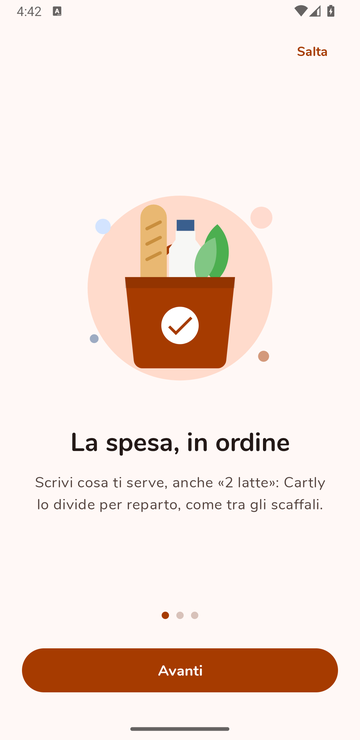
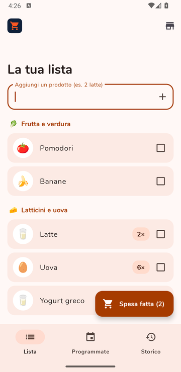
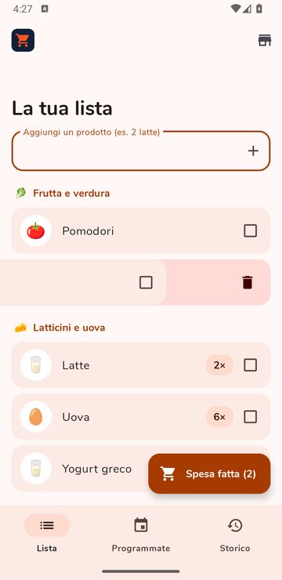
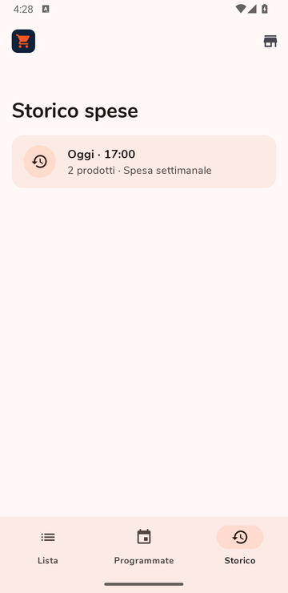
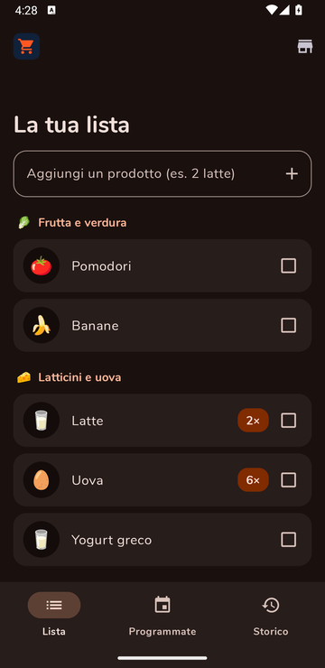

# 🛒 Cartly

**La lista della spesa che si mette in ordine da sola.**
Scrivi cosa ti serve, Cartly lo divide per reparto come tra gli scaffali del supermercato, ti ricorda quando hai programmato la spesa e tiene lo storico di quello che hai comprato.

App Android realizzata in collaborazione da **Giuseppe Cuiuri** e **Davide Cinelli** per il corso di **Ambienti di programmazione e programmazione mobile** dell'**Università della Calabria (UniCal)**.

<p align="center">
  
  
  
  
  
</p>

## Funzionalità

- **Lista divisa per reparto.** Ogni prodotto finisce da solo nel reparto giusto (Frutta e verdura, Latticini e uova, Dispensa, Casa e pulizia…) con la sua emoji, riconosciuto dal nome.
- **Quantità al volo.** Scrivendo «2 latte» o «uova 6» la quantità viene letta in automatico; tenendo premuto un prodotto si cambia.
- **Spunta mentre compri.** Un tocco mette il prodotto nel carrello: scende in fondo alla lista, attenuato. Alla cassa, «Spesa fatta» sposta tutto nello storico.
- **Eliminare scorrendo**, con «Annulla» per tornare indietro.
- **Spese programmate con promemoria.** Scegli giorno e ora: una notifica arriva un'ora prima, anche dopo il riavvio del telefono.
- **Storico.** Per ogni spesa fatta, cosa hai comprato; con «Rimetti in lista» la rifai in un tocco.
- **Supermercati vicini.** Un pulsante apre Google Maps con la ricerca intorno a te.
- **Introduzione al primo avvio**, tema chiaro e scuro, testi in italiano e supporto a TalkBack.

Nessun account e nessuna connessione: i dati restano sul telefono.

## Tecnologie

| | |
|---|---|
| Linguaggio | Java 8 |
| Piattaforma | Android, minSdk 28 (Android 9), targetSdk 34 |
| Interfaccia | Material Design 3 (Material Components), RecyclerView, ViewPager2 |
| Dati | SQLite con `SQLiteOpenHelper` (schema alla versione 5, con migrazioni) |
| Promemoria | `AlarmManager` e notifiche, ripristinati al riavvio (`BOOT_COMPLETED`) |
| Build | Gradle (Kotlin DSL), Android Gradle Plugin 8.2 |

## Struttura del codice

Tutto si trova in `app/src/main/java/com/example/cartly/`:

| File | Cosa fa |
|---|---|
| `MainActivity` | L'unica schermata: titolo grande, le tre schede e il pulsante principale |
| `ShoppingListFragment` | La lista della spesa per reparto, spunte, quantità, «Spesa fatta» |
| `PlannedFragment`, `NewShoppingDialogFragment` | Le spese programmate e la finestra per crearne una |
| `HistoryFragment`, `ShoppingDoneDialogFragment` | Lo storico e il dettaglio di una spesa |
| `Catalog` | Riconosce reparto ed emoji dal nome del prodotto |
| `DBHelper`, `DBManager` | Il database: tabelle, migrazioni e tutte le query |
| `NotificationReceiver`, `BootReceiver` | I promemoria e il loro ripristino dopo un riavvio |
| `OnboardingActivity` | Le tre pagine di introduzione al primo avvio |
| `Ui` | Funzioni comuni: date, quantità, liste vuote, scorrimento per eliminare |

## Come provarla

1. Apri la cartella del progetto con **Android Studio** (*File → Open*).
2. Attendi il **Gradle Sync**.
3. Scegli un emulatore o un telefono collegato e premi **Run ▶**.

I test sul riconoscimento dei reparti e sulla lettura delle quantità girano sul computer, senza telefono: tasto destro su `app/src/test/java/com/example/cartly/CatalogTest.java` → **Run 'CatalogTest'**, oppure da terminale:

```bash
./gradlew test
```

## Licenza

Distribuito con licenza **MIT**: vedi il file [LICENSE](LICENSE).

## Crediti

- Carattere **Nunito** — © 2014 The Nunito Project Authors, [SIL Open Font License 1.1](https://openfontlicense.org).
- Icone **Material Icons** di Google — [Apache License 2.0](https://www.apache.org/licenses/LICENSE-2.0).
- Le illustrazioni, il logo e l'icona dell'app sono stati realizzati per questo progetto.

---

<p align="center">
  Giuseppe Cuiuri · Davide Cinelli<br>
  Ambienti di programmazione e programmazione mobile — Università della Calabria
</p>
